

  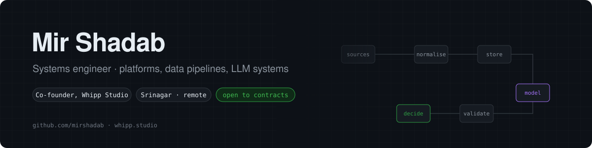

  <a href="https://www.whipp.studio">whipp.studio</a> ·
  <a href="https://www.linkedin.com/in/mir-shadab">LinkedIn</a> ·
  <a href="mailto:mirrshadab@gmail.com">mirrshadab@gmail.com</a> ·
  <a href="docs/profile-evidence.md">How every claim here is sourced</a>

I build systems where the hard part isn't the screen but the data and the decision behind it: collectors that respect a site's terms, schemas that refuse bad rows, databases that enforce money rules on their own, and language models that are allowed to *propose* but never to be the source of truth. Most of my work ships as TypeScript on Cloudflare's edge or as Python data tooling, and increasingly has an LLM somewhere in the loop — always behind validation, evidence and a human gate.

**Right now:** a labour-market demand intelligence engine (44 data collectors, DuckDB, Claude-graded opportunity reviews) and a multi-tenant operations SaaS on Workers.

---

## Highlights

Snapshot of 18 Oct 2026. Every figure links back to a source in [`docs/profile-evidence.md`](docs/profile-evidence.md); the charts further down refresh daily.

| | Figure | What it counts |
| :-- | --: | :-- |
| Contributions, last 365 days | **1,025** | GitHub contribution calendar, private counts included |
| Contributions in 2026 so far | **994** | vs 71 in 2025 — the year this account became my main workspace |
| Commits attributed | **988** | across 26 repositories, Jun 2025 – Oct 2026 |
| Busiest day / month | **86 / 318** | 5 Jul 2026 / Sep 2026 |
| Repositories | **72** | 58 private, 14 public, 3 of them forks |
| Largest system | **44 collectors · 265 tests** | demand engine, per its README (private) |
| Deployed industry builds | **29** | studio website builds on Vercel across 9 sectors |

> This account dates from December 2024. Earlier work lived on an account I can no longer access — see [Experience](#experience) for what is and isn't on the record.

---

## How I build

1. **Deterministic first, model second.** If data has a shape, parse it. Spreadsheets go through a typed CSV path; only messy sources (PDFs, scans, free text) go to a model.
2. **The model proposes; code decides.** Every LLM output is re-validated against a schema, invalid rows are dropped *and counted*, and anything that changes real data passes an operator review gate.
3. **Every judgement cites evidence.** Model-written verdicts reference evidence by ID (`E1`, `E2`, …); a section with no data says *why* it's empty instead of guessing.
4. **Let the database hold the line.** Row-level security and atomic SQL functions for every financial state change, so no API bug can double-spend.
5. **Collect politely, store minimally.** Official APIs before scraping, `robots.txt` obeyed, per-host rate limits, PII scrubbed at ingestion, licence recorded on every row.
6. **Make AI testable.** Model clients sit behind an interface with an injectable transport, so the pipeline is tested with stubs and the provider can be swapped in one line.

---

## Selected systems

<table>
<tr><td>

### 1 · Labour-market demand intelligence engine
`private` · `active R&D` · Python · DuckDB · Parquet · Next.js · Cloudflare R2 · Claude API

**Problem.** Find work that people repeatedly pay for — and where startups already earn revenue from it — using evidence rather than intuition.

**What it is.** A research engine that pulls job, gig and project postings plus startup and company-registry data from **44 collectors** (government open data in ten countries, ATS job-board APIs, Web Data Commons, Kaggle history sets, OpenAlex papers), normalises them into one schema and serves an analytics dashboard.

**Interesting engineering**
- Polite HTTP client with per-host rate limits, retries and `robots.txt` checks; terms-of-use reviewed per source, with non-compliant sources held back until written consent.
- PII stripped at ingestion; research papers keep institutions, never author names.
- Parquet partitions per source and run, DuckDB views on top, daily GitHub Actions run → R2 → dashboard.
- Job-title taxonomy as ordered rules (EN/DE/FR), with the "Other" share per source surfaced so rule gaps are measurable; niches derived from title phrases weighted by how specific they are to a sub-category.
- **Idea Lab:** an LLM evaluation step (Claude, structured outputs) that maps an idea to the taxonomy, builds an evidence pack from the data and returns a build / pivot / drop verdict in which **every reason cites an evidence ID**; output is schema-validated before it is stored, and the client is stubbable for tests.

**Trade-off.** Rules over a classifier for the first taxonomy pass — cheap, inspectable, and the error rate is visible per source. Near-duplicate detection (MinHash) is deliberately deferred; exact fingerprints first.

**Maturity.** Internal tool, running daily. The README documents 265 tests; I have not executed them as part of this profile audit.

</td></tr>
<tr><td>

### 2 · Multi-tenant booking and operations SaaS
`private` · `in development` · TypeScript · Hono on Cloudflare Workers · Nuxt · Astro · Drizzle · Turborepo

**Problem.** One platform that runs many independent operators — bookings, payments, documents and public storefronts — without one tenant's data or config leaking into another's.

**Architecture.** A Turborepo monorepo: Hono API on Workers; three Nuxt apps (operator dashboard, storefront, super-admin) and an Astro marketing site; shared packages for domain logic (`core`), payment gateways (Stripe and Razorpay behind one registry, HMAC verification), PDF generation, SEO and AI. **82 migration files and 82 test files** in the repository.

**AI component.** Fleet import from messy sources: an `AIProvider` interface over any OpenAI-compatible endpoint (NVIDIA NIM in development, swappable in one line) extracts vehicle rows from free text; the response is parsed tolerantly, every row is re-validated with Zod, invalid rows are counted, and the result goes to an operator review gate. Structured spreadsheets never touch the model.

**SEO package.** JSON-LD, sitemaps, robots, Markdown views and `llms.txt` generated per tenant so AI answer engines describe each operator accurately.

</td></tr>
<tr><td>

### 3 · Database-as-backend financial state machine
`private` · `phase 1 verified` · Next.js · Supabase Postgres · RLS · Cloudflare

**Problem.** A product where users move money between each other — the kind of system where a race condition is a financial bug.

**Approach.** Postgres holds the rules: row-level security on every table and **one atomic SQL function per financial state transition** (create, give, boost, extend, expire, shuffle). 52 migration files, scripts that audit database privileges, and a decision log. The money core is marked verified; payment collection is not switched on yet, so the product is not live.

</td></tr>
<tr><td>

### 4 · Retrieval-first content and commerce sites
`private` · `shipped / in development` · Astro · Cloudflare (Workers, D1) · Better Auth · payment gateways

**Thesis.** For many sites the first reader is now a retrieval system, not a person. These builds treat that as an architectural requirement: typed content collections for answers, guides and glossaries; JSON-LD builders (`BlogPosting`, `FAQPage`, `BreadcrumbList`); `llms.txt`; query-cluster maps derived from research; and Google Search Console data in the database. Spread across four Astro codebases on Cloudflare — three of them with 11–16 SQL migrations — plus auth and Indian payment-gateway integrations.

**Open question.** Whether this measurably increases citations by AI answer engines — tracked as research item R7 below, with no result claimed yet.

</td></tr>
</table>

<b>Compact index of other work</b>

| Class of work | Evidence | Notes |
| :-- | :-- | :-- |
| Marketplace with OAuth account verification and subscriptions | Next.js 16 · Prisma 7 · Better Auth (Google, Reddit, X linking) · 23 migrations · Vitest | private |
| 29 deployed industry website builds | Vite + React + Motion builds on Vercel across healthcare, legal, real estate, automotive, e-commerce and services | studio work; template-grade, not individual client case studies |
| Structured generation prototypes | Google Genkit + Gemini flows with Zod input/output schemas | prototypes |
| Vue 3 / TypeScript front-end systems | Vue 3, Pinia, Nuxt, Supabase, Stripe | [promptedit](https://github.com/mirshadab/promptedit) is public |
| Open-source systems studied | Forks of a swarm-intelligence prediction engine and a local-first AI assistant | forks only; no commits of mine |

---

## AI, ML and LLM engineering

What is implemented, what is a prototype, and what is still research — kept separate on purpose.

### Systems portfolio

| System / investigation | Problem | Architecture | Models / methods | Evaluation | Status | Evidence |
| :-- | :-- | :-- | :-- | :-- | :-: | :-- |
| Opportunity evaluation (Idea Lab) | Judge a product idea against market evidence without unsupported claims | DuckDB evidence pack → two structured-output calls (taxonomy match, verdict) → schema check → versioned store | Claude API · structured outputs · adaptive thinking · streaming | Schema validity and evidence-ID coverage enforced; agreement with human decisions not yet measured | `implemented` | private repo · [R3](#research-programme) |
| Messy-source extraction | Turn PDFs and free text into typed fleet records safely | OpenAI-compatible provider interface → tolerant JSON parse → per-row Zod validation → review gate | NVIDIA NIM (dev) · swappable endpoint | Unit tests with injected transport; field accuracy not yet measured | `implemented` | private repo · [R2](#research-programme) |
| Demand-signal mining | Find recurring paid work across 44 heterogeneous sources | Collectors → normalise → PII scrub → fingerprint dedupe → Parquet / DuckDB → taxonomy | Rule-based classification (EN/DE/FR) · specificity-weighted phrase mining | "Other" share per source exposed on the dashboard | `implemented` | private repo · [R4](#research-programme) |
| Agentic analysis workflow | Let a coding agent run a repeatable, auditable evaluation | Repository skill → CLI evidence fetch → SQL over Parquet → validated save | Claude Code skills | Output validated by the same schema as the API path | `implemented` | private repo |
| Structured generation flows | Generate product copy from typed inputs | Genkit flows with Zod input / output schemas | Google Gemini via Genkit | None | `prototype` | private repos |
| Retrieval over the demand corpus | Answer questions about postings and papers with citations | Embeddings · hybrid retrieval · re-ranking (planned) | Not yet selected | Recall@k, MRR on hand-labelled queries (planned) | `planned` | [R8](#research-programme) |

| Area | What exists in code | Status |
| :-- | :-- | :-: |
| **LLM application engineering** | Claude API with structured outputs and adaptive thinking, streaming for long prompts, server-side refusal fallback treated as an error; OpenAI-compatible provider abstraction | `implemented` |
| **Schema-validated generation** | Zod / JSON-schema validation on every model response; invalid rows dropped and counted; validated before storage | `implemented` |
| **Evidence-grounded evaluation** | Verdicts must cite evidence IDs from a curated evidence pack (capped at 400 items, 8 taxonomy matches); empty sections must state why | `implemented` |
| **Human-in-the-loop** | Operator review gate on AI-extracted data; build / pivot / drop decisions remain human | `implemented` |
| **Agentic workflows** | Repository-scoped Claude Code skills that run CLI steps, query Parquet/DuckDB with SQL and save a validated result | `implemented` |
| **Data intelligence** | 44 collectors, normalisation, PII scrubbing, cross-source fingerprint dedupe, rule-based taxonomy, specificity-weighted phrase mining | `implemented` |
| **Inference providers** | Anthropic Claude (production path), NVIDIA NIM via OpenAI-compatible API (dev path), Google Gemini via Genkit (prototype) | `implemented` / `prototype` |
| **Retrieval and RAG** | Retrieval-first content architecture and `llms.txt`; **no embedding or vector-search pipeline in the audited repositories** | `researching` |
| **Near-duplicate detection** | MinHash over descriptions, designed and scheduled | `planned` |
| **Multi-agent simulation** | Studied an open-source swarm engine; persona simulation is a section of the Idea Lab dossier | `exploring` |
| **Evaluation methodology** | Schema validity and citation coverage are enforced; quality metrics (Recall@k, MRR, human grading) not yet run | `planned` |
| **Training / fine-tuning** | None. I integrate, prompt, constrain and evaluate models; I have not trained one | — |

---

## Architecture atlas

<b>1 · Engineering lifecycle</b> — how a problem becomes a running system

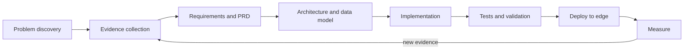

<b>2 · LLM evaluation pipeline</b> — as implemented in the demand engine

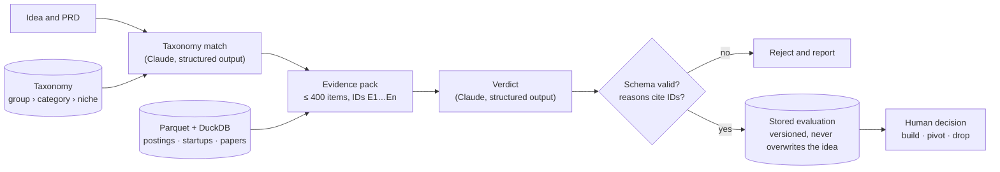

<b>3 · Model-as-proposer extraction</b> — as implemented in the operations SaaS

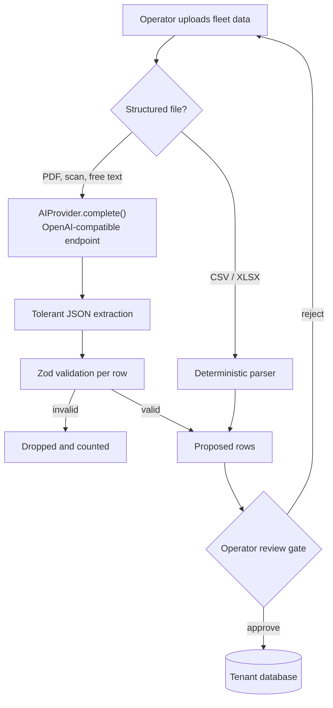

<b>3b · Agent execution</b> — the Idea Lab skill, as implemented

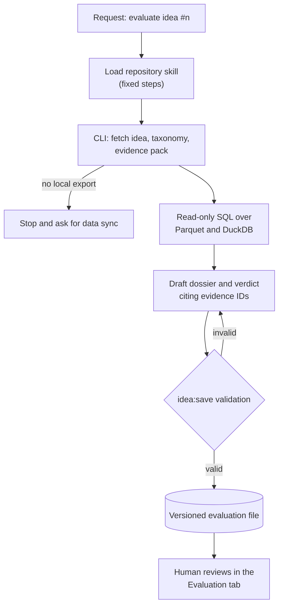

Tool actions run inside the coding agent's own permission prompts; the skill only reads data and writes through the validating save command. Retries happen at the validation step, not by re-running data collection.

<b>4 · Data intelligence pipeline</b> — collectors to dashboard

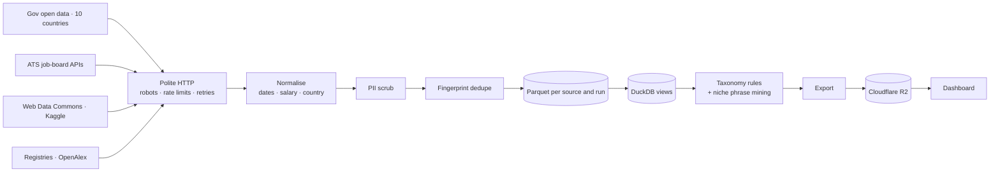

<b>5 · Delivery cycle</b> — research to release

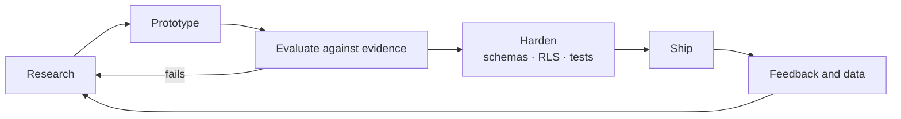

---

## Research programme

Status is earned: an item is **completed** only when it produced a recorded outcome.

| ID | Question | Status |
| :-- | :-- | :-: |
| R1 | Which demand-data sources can legally be used for ongoing research? | `completed` |
| R2 | Can an LLM extraction step be made safe enough to touch tenant data? | `implemented · accuracy open` |
| R3 | Do evidence-cited LLM verdicts make opportunity reviews more trustworthy? | `active` |
| R4 | How far does a rule-based job taxonomy get before a learned model is needed? | `active` |
| R5 | Near-duplicate postings across sources | `planned` |
| R6 | Can multi-agent persona simulation add signal to market evidence? | `exploring` |
| R7 | Does retrieval-first site architecture increase AI answer-engine citations? | `exploring` |
| R8 | RAG over the demand corpus | `planned` |
| R9 | Inference economics for structured extraction | `planned` |

<b>R1 · Data-source legality and coverage</b> — completed

- **Question.** Which job, gig, startup and research sources can be used for *ongoing* research without breaching terms?
- **Hypothesis.** Enough coverage exists in official APIs, open data and permissively licensed datasets that scraping behind logins is unnecessary.
- **Tools.** Manual terms review, a platform catalogue in CSV, robots-aware HTTP client; no models.
- **Method.** Catalogued 345 demand sources, 39 revenue sources and ~530 platforms with endpoints, limits and reuse terms; reviewed each source's licence before writing a collector.
- **Result.** Collectors built for 44 sources. Two platforms held back despite working collectors because their terms restrict ongoing research use or caching; Kaggle and Web Data Commons licences recorded on every row.
- **Conclusion.** Hypothesis held: broad multi-country coverage without logins, proxies or CAPTCHA solving.
- **Limitation.** Terms change; the catalogue needs periodic review.
- **Next.** Re-check held sources once written consent arrives.

<b>R2 · Model-as-proposer extraction</b> — implemented, accuracy not yet measured

- **Hypothesis.** An LLM can safely turn messy fleet documents into rows if it can only *propose* and every row is re-validated and reviewed.
- **Method.** OpenAI-compatible provider (NVIDIA NIM in dev), tolerant JSON extraction, Zod validation per row, skipped-row counts, operator review gate; deterministic path for structured files. Unit-tested with an injected `fetch`.
- **Result.** Design implemented and tested for parsing and validation behaviour.
- **Open.** No labelled set yet, so precision and recall of extraction are unknown.
- **Next.** Build a small golden set of real documents; measure field-level precision/recall and the share of rows dropped by validation, per model.

<b>R3 · Evidence-cited LLM verdicts</b> — active

- **Hypothesis.** Forcing every reason to cite an evidence ID, and every empty section to explain itself, makes model judgements auditable and reduces unsupported claims.
- **Method.** Claude structured outputs over a capped evidence pack; schema validation before storage; versioned evaluations that never overwrite the idea.
- **Criteria.** Schema validity (enforced); citation coverage (enforced); agreement with human decisions (not yet measured).
- **Limitations.** A cited ID proves provenance, not that the reasoning from it is sound; one model family only.
- **Current conclusion.** Open — the mechanism works; its value over an uncited verdict is unmeasured.
- **Next.** Log human build / pivot / drop decisions next to model verdicts and measure agreement.

<b>R4 · Rules vs a learned taxonomy</b> — active

- **Hypothesis.** Ordered multilingual rules cover most job titles well enough for a first pass.
- **Method.** Rules match title plus the source's own category; the "Other" share per source is reported on the dashboard.
- **Result so far.** The miss rate is observable per source; no learned classifier has been compared yet.
- **Limitations.** Rules favour the languages and phrasings already seen; new sources need new rules.
- **Current conclusion.** Good enough to rank categories; not yet good enough to trust long-tail niches.
- **Next.** Map categories to O*NET / ESCO, then compare rules with an embedding-based classifier on a labelled sample.

<b>R5–R9 · Exploratory and planned</b>

- **R5 Near-duplicates.** MinHash over descriptions after exact fingerprints. Metric: duplicate pairs found vs manual sample.
- **R6 Persona simulation.** Studying an open-source swarm engine; question is whether simulated buyer personas add anything beyond the market evidence. No result claimed.
- **R7 AI-search citations.** Sites ship JSON-LD, `llms.txt` and answer-shaped content; next step is a fixed query set checked across answer engines over time.
- **R8 RAG over the corpus.** Embeddings and hybrid retrieval over postings and papers, evaluated with Recall@k and MRR on hand-labelled queries.
- **R9 Inference economics.** Claude vs NIM-hosted open-weight models vs local inference on the extraction task: validity rate, latency and cost per 100 rows.

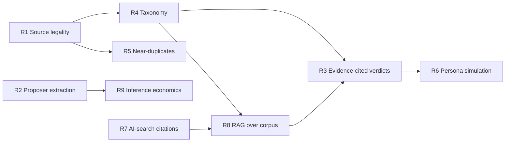

---

## Experience

| Period | Role | Basis |
| :-- | :-- | :-- |
| 2025 – present | **Co-founder and delivery lead, [Whipp Studio](https://www.whipp.studio)** — engineering standards, architecture and delivery for studio builds | Profile and studio site |
| 2025 – present | **Independent full-stack engineer** — platforms, e-commerce and content systems on Cloudflare, Supabase and Postgres | Repository history on this account |
| 2026 – present | **Data and AI systems R&D** — demand intelligence engine, LLM evaluation and extraction | Repository history on this account |
| 2021 – 2024 | **Freelance full-stack engineer, Upwork and Whipp Studio** — web applications, e-commerce builds, front-end engineering and technical SEO for international clients | Stated; code history sits on a previous GitHub account (see note) |

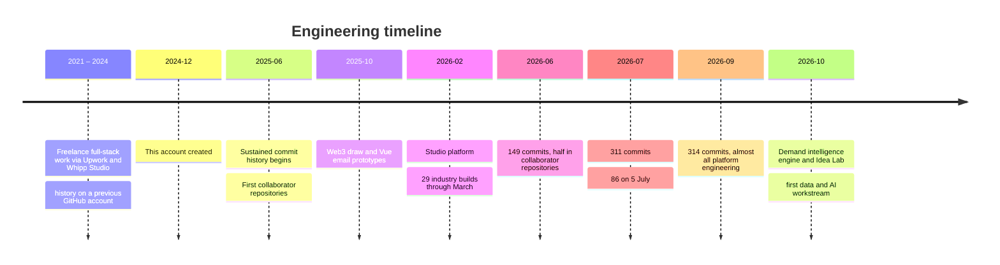

> **On 2021–2024:** I worked as a freelancer through Upwork and Whipp Studio. The code from that period sits on a GitHub account I lost access to, so it isn't counted in the charts here; I have not recreated it, and nothing on this profile is backdated. Happy to walk through that work on request — and see [`docs/SETUP.md`](docs/SETUP.md#recovering-historical-contributions) for how verified old commits can be re-attached legitimately.

---

## Contribution intelligence

  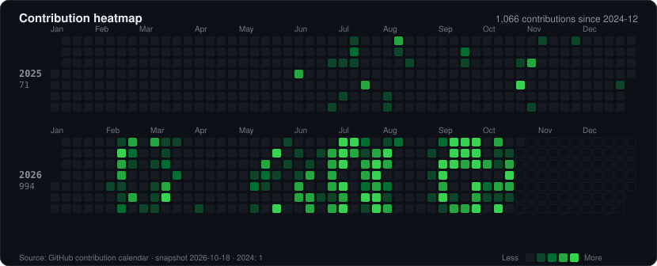

  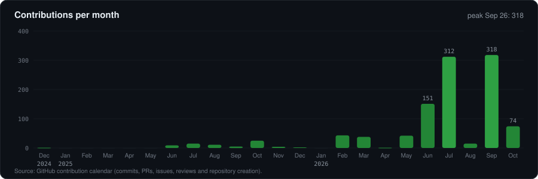

  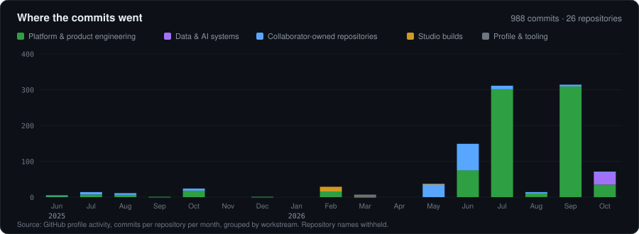

  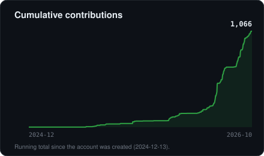
  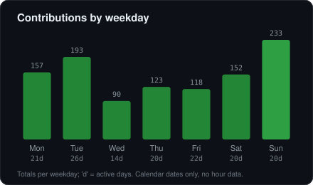

| Year | Contributions | Note |
| :-- | --: | :-- |
| 2024 | 1 | account created 13 Dec |
| 2025 | 71 | |
| 2026 (to 18 Oct) | 994 | 14× 2025 |

**Definitions.** *Contributions* are GitHub's calendar counts (commits to default branches, PRs, issues, reviews, new repositories), with private ones counted but not shown. *Commits* come from the profile's per-repository activity. Most work is solo on private repositories and lands without pull requests, so PRs are few (4 opened, 1 merged) and reviews are rare — a reflection of team size rather than process.

<picture>
  <source media="(prefers-color-scheme: dark)" srcset="https://raw.githubusercontent.com/mirshadab/mirshadab/output/snake-dark.svg" />
  
</picture>

---

## Repositories

  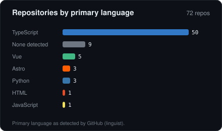

| Category | Repos |
| :-- | --: |
| Studio and industry website builds | 41 |
| Platforms and products | 18 |
| Prototypes and empty placeholders | 8 |
| Forks studied (no commits of mine) | 3 |
| Data and AI systems | 1 |
| Profile | 1 |

---

## Technology

Grouped by what I've actually done with each, not by how confident I feel about it.

| | Built and shipped | Implemented in active codebases | Prototyped | Researching |
| :-- | :-- | :-- | :-- | :-- |
| **Languages** | TypeScript, SQL | Python | | |
| **Front-end** | React, Next.js, Astro, Vite, Tailwind, Motion | Vue 3, Nuxt, Pinia | | |
| **Back-end and edge** | Cloudflare Workers / Pages / D1, Supabase, Vercel | Hono, Drizzle, Prisma, Turborepo | | |
| **Data** | Postgres (RLS, SQL functions) | DuckDB, Parquet, pandas, PyArrow, httpx, R2 | | |
| **AI models and APIs** | | Anthropic Claude API, NVIDIA NIM (OpenAI-compatible) | Google Genkit + Gemini | open-weight and local inference |
| **LLM engineering** | | Structured outputs, schema validation, evidence citation, review gates | | RAG, embeddings, re-ranking |
| **Agents** | | Claude Code repository skills | | MCP servers, multi-agent simulation |
| **Evaluation** | | Schema and citation checks, stubbed-model tests | | Golden sets, Recall@k, MRR, human agreement |
| **Auth and payments** | Better Auth, Supabase Auth | Stripe, Razorpay, PayU, Dodo Payments, HMAC webhooks | | |
| **Testing and CI** | GitHub Actions | Vitest, pytest, Playwright | | |
| **Search** | JSON-LD, sitemaps, `llms.txt`, technical SEO | Search Console data pipelines | | AI answer-engine citation tracking |

---

## Now investigating

- **Does an evidence-cited LLM verdict agree with a human's?** Logging decisions next to verdicts (R3).
- **How accurate is model-proposed extraction, per model?** Building a golden set (R2, R9).
- **Where do rules stop and embeddings start?** Taxonomy comparison, then retrieval over the corpus (R4 → R8).

Questions about any of it: [mirrshadab@gmail.com](mailto:mirrshadab@gmail.com).

---

Charts are rendered from <code>data/*.json</code> by <code>scripts/build_charts.py</code> and refreshed daily by <code>.github/workflows/profile-data.yml</code>. The snake is generated by <code>.github/workflows/snake.yml</code>. Claims and their sources: <a href="docs/profile-evidence.md">docs/profile-evidence.md</a>.
